# Perancangan Basis Data (Entity Relationship Diagram)

## 1. Pendahuluan dan Definisi Notasi ERD

Perancangan basis data konseptual pada sistem audit manifest software laboratorium ini dimodelkan menggunakan **Entity Relationship Diagram (ERD) Notasi Chen** (Peter Chen, 1976). Notasi Chen dipilih karena secara eksplisit memisahkan representasi entitas, hubungan asosiasi (relasi), serta atribut spesifik pada masing-masing komponen, termasuk kemampuan mendefinisikan atribut transaksi yang melekat langsung pada relasi banyak-ke-banyak (*associative relationship*).

### Tabel 1. Definisi Notasi ERD (Notasi Chen)
| Simbol Grafis | Bentuk Geometri | Makna dan Fungsi |
| :--- | :--- | :--- |
| **Entitas (Entity)** | Persegi Panjang (*Rectangle*) | Merepresentasikan objek fisik atau konseptual yang datanya disimpan dan dikelola dalam sistem. |
| **Relasi (Relationship)** | Belah Ketupat (*Rhombus/Diamond*) | Merepresentasikan keterhubungan logis antar satu atau lebih entitas. |
| **Atribut (Attribute)** | Elips / Oval (*Ellipse*) | Karakteristik, properti, atau informasi spesifik yang mendeskripsikan suatu entitas atau relasi. |
| **Primary Key (PK)** | Oval dengan Tanda Bintang Satu (`*`) | Atribut unik yang menjadi identitas utama pembeda setiap baris data pada entitas. |
| **Foreign Key (FK)** | Oval dengan Tanda Bintang Dua (`**`) | Atribut penunjuk kunci asing yang mereferensikan primary key dari entitas lain. |
| **Kardinalitas** | Label Angka/Huruf (`1`, `N`, `M`) | Menunjukkan derajat kuantitatif keterhubungan antar entitas (1-ke-1, 1-ke-N, atau M-ke-N). |

---

## 2. Diagram ERD Notasi Chen

Berikut adalah visualisasi Notasi Chen lengkap untuk sistem audit manifest software. File sumber grafis berekstensi Draw.io tersedia pada direktori repositori: `docs/diagrams/erd/erd-chen-audit-manifest.drawio` (siap diekspor ke format PNG resolusi tinggi atau PDF vektor untuk dicetak pada naskah skripsi).

```mermaid
flowchart TB
    %% ==========================================
    %% ER DIAGRAM NOTASI CHEN - AUDIT MANIFEST SOFTWARE
    %% ==========================================

    %% Styling Classes
    classDef entity fill:#ffffff,stroke:#1d1d1f,stroke-width:2.5px,font-weight:bold,color:#1d1d1f;
    classDef rel fill:#ffffff,stroke:#1d1d1f,stroke-width:2px,font-weight:bold,color:#1d1d1f;
    classDef attrPk fill:#f0f7ff,stroke:#0071e3,stroke-width:2px,font-weight:bold,color:#0071e3;
    classDef attrFk fill:#fafafa,stroke:#555555,stroke-width:1.5px,stroke-dasharray: 4 2,color:#333333;
    classDef attr fill:#ffffff,stroke:#1d1d1f,stroke-width:1.5px,color:#1d1d1f;
    classDef attrRel fill:#fef9e7,stroke:#d4ac0d,stroke-width:1.5px,color:#7d6608;

    %% ------------------------------------------
    %% 1. ENTITAS: FAKULTAS
    %% ------------------------------------------
    E_FAKULTAS["<b>fakultas</b>"]:::entity
    A_FAK_ID(["id_fakultas *"]):::attrPk
    A_FAK_NAMA(["nama_fakultas"]):::attr
    A_FAK_KODE(["kode_fakultas"]):::attr

    E_FAKULTAS --- A_FAK_ID
    E_FAKULTAS --- A_FAK_NAMA
    E_FAKULTAS --- A_FAK_KODE

    %% Relasi: fakultas -- memiliki -- laboratorium (1:N)
    R_MEMILIKI{"<b>memiliki</b>"}:::rel
    E_FAKULTAS ---|1| R_MEMILIKI
    R_MEMILIKI ---|N| E_LAB

    %% ------------------------------------------
    %% 2. ENTITAS: LABORATORIUM
    %% ------------------------------------------
    E_LAB["<b>laboratorium</b>"]:::entity
    A_LAB_ID(["id_lab *"]):::attrPk
    A_LAB_FAK(["id_fakultas **"]):::attrFk
    A_LAB_NAMA(["nama_lab"]):::attr
    A_LAB_LOK(["lokasi"]):::attr

    E_LAB --- A_LAB_ID
    E_LAB --- A_LAB_FAK
    E_LAB --- A_LAB_NAMA
    E_LAB --- A_LAB_LOK

    %% Relasi: laboratorium -- menugaskan -- pengguna (1:N)
    R_MENUGASKAN{"<b>menugaskan</b>"}:::rel
    E_LAB ---|1| R_MENUGASKAN
    R_MENUGASKAN ---|N| E_USER

    %% Relasi: laboratorium -- menempatkan -- komputer (1:N)
    R_MENEMPATKAN{"<b>menempatkan</b>"}:::rel
    E_LAB ---|1| R_MENEMPATKAN
    R_MENEMPATKAN ---|N| E_KOMPUTER

    %% ------------------------------------------
    %% 3. ENTITAS: PENGGUNA
    %% ------------------------------------------
    E_USER["<b>pengguna</b>"]:::entity
    A_USER_ID(["id_user *"]):::attrPk
    A_USER_LAB(["id_lab **"]):::attrFk
    A_USER_NAMA(["nama"]):::attr
    A_USER_EMAIL(["email"]):::attr
    A_USER_ROLE(["role"]):::attr

    E_USER --- A_USER_ID
    E_USER --- A_USER_LAB
    E_USER --- A_USER_NAMA
    E_USER --- A_USER_EMAIL
    E_USER --- A_USER_ROLE

    %% Relasi: pengguna -- menyetujui -- laporan_audit (1:N)
    R_MENYETUJUI{"<b>menyetujui</b>"}:::rel
    E_USER ---|1| R_MENYETUJUI
    R_MENYETUJUI ---|N| E_LAPORAN

    %% ------------------------------------------
    %% 4. ENTITAS: KOMPUTER
    %% ------------------------------------------
    E_KOMPUTER["<b>komputer</b>"]:::entity
    A_KOMP_ID(["id_komputer *"]):::attrPk
    A_KOMP_LAB(["id_lab **"]):::attrFk
    A_KOMP_HOST(["hostname"]):::attr
    A_KOMP_MAC(["mac_address"]):::attr
    A_KOMP_IP(["ip_address"]):::attr
    A_KOMP_OS(["os_name"]):::attr
    A_KOMP_STAT(["status"]):::attr

    E_KOMPUTER --- A_KOMP_ID
    E_KOMPUTER --- A_KOMP_LAB
    E_KOMPUTER --- A_KOMP_HOST
    E_KOMPUTER --- A_KOMP_MAC
    E_KOMPUTER --- A_KOMP_IP
    E_KOMPUTER --- A_KOMP_OS
    E_KOMPUTER --- A_KOMP_STAT

    %% Relasi: komputer -- menginstal -- katalog_software (M:N)
    R_MENGINSTAL{"<b>menginstal</b>"}:::rel
    A_INST_VER(["versi_terpasang"]):::attrRel
    A_INST_STAT(["status_kepatuhan"]):::attrRel

    E_KOMPUTER ---|M| R_MENGINSTAL
    R_MENGINSTAL ---|N| E_SOFTWARE
    R_MENGINSTAL --- A_INST_VER
    R_MENGINSTAL --- A_INST_STAT

    %% ------------------------------------------
    %% 5. ENTITAS: KATALOG_SOFTWARE
    %% ------------------------------------------
    E_SOFTWARE["<b>katalog_software</b>"]:::entity
    A_SOFT_ID(["id_software *"]):::attrPk
    A_SOFT_NAMA(["nama_software"]):::attr
    A_SOFT_KAT(["kategori"]):::attr
    A_SOFT_VEND(["vendor"]):::attr

    E_SOFTWARE --- A_SOFT_ID
    E_SOFTWARE --- A_SOFT_NAMA
    E_SOFTWARE --- A_SOFT_KAT
    E_SOFTWARE --- A_SOFT_VEND

    %% Relasi: katalog_software -- mencakup -- lisensi (1:N)
    R_MENCAKUP{"<b>mencakup</b>"}:::rel
    E_SOFTWARE ---|1| R_MENCAKUP
    R_MENCAKUP ---|N| E_LISENSI

    %% ------------------------------------------
    %% 6. ENTITAS: LISENSI
    %% ------------------------------------------
    E_LISENSI["<b>lisensi</b>"]:::entity
    A_LIS_ID(["id_lisensi *"]):::attrPk
    A_LIS_SOFT(["id_software **"]):::attrFk
    A_LIS_NO(["nomor_lisensi"]):::attr
    A_LIS_TIPE(["tipe_lisensi"]):::attr
    A_LIS_KUOTA(["jumlah_kuota"]):::attr
    A_LIS_EXP(["tgl_kadaluarsa"]):::attr

    E_LISENSI --- A_LIS_ID
    E_LISENSI --- A_LIS_SOFT
    E_LISENSI --- A_LIS_NO
    E_LISENSI --- A_LIS_TIPE
    E_LISENSI --- A_LIS_KUOTA
    E_LISENSI --- A_LIS_EXP

    %% Relasi: fakultas -- dialokasikan -- lisensi (M:N)
    R_DIALOKASIKAN{"<b>dialokasikan</b>"}:::rel
    A_ALOK_KUOTA(["kuota_alokasi"]):::attrRel
    A_ALOK_TGL(["tgl_alokasi"]):::attrRel

    E_FAKULTAS ---|M| R_DIALOKASIKAN
    R_DIALOKASIKAN ---|N| E_LISENSI
    R_DIALOKASIKAN --- A_ALOK_KUOTA
    R_DIALOKASIKAN --- A_ALOK_TGL

    %% ------------------------------------------
    %% 7. ENTITAS: LAPORAN_AUDIT
    %% ------------------------------------------
    E_LAPORAN["<b>laporan_audit</b>"]:::entity
    A_LAP_ID(["id_laporan *"]):::attrPk
    A_LAP_LAB(["id_lab **"]):::attrFk
    A_LAP_USER(["id_user **"]):::attrFk
    A_LAP_PER(["periode"]):::attr
    A_LAP_STAT(["status_kepatuhan"]):::attr
    A_LAP_TGL(["tgl_audit"]):::attr

    E_LAPORAN --- A_LAP_ID
    E_LAPORAN --- A_LAP_LAB
    E_LAPORAN --- A_LAP_USER
    E_LAPORAN --- A_LAP_PER
    E_LAPORAN --- A_LAP_STAT
    E_LAPORAN --- A_LAP_TGL

    %% Relasi: laboratorium -- diaudit -- laporan_audit (1:N)
    R_DIAUDIT{"<b>diaudit</b>"}:::rel
    E_LAB ---|1| R_DIAUDIT
    R_DIAUDIT ---|N| E_LAPORAN
```

---

## 3. Deskripsi Entitas

Sistem perancangan basis data mencakup 7 entitas utama yang merepresentasikan struktur operasional universitas dan tata kelola lisensi perangkat lunak:

1. **Entitas Fakultas (`fakultas`)**: Menyimpan data unit pengelola fakultas di lingkungan Universitas Sembilanbelas November (USN) Kolaka yang menaungi laboratorium dan menerima alokasi kuota lisensi software universitas.
2. **Entitas Laboratorium (`laboratorium`)**: Menyimpan data identitas ruangan laboratorium komputer sebagai unit operasional tempat perangkat keras dan perangkat lunak ditempatkan.
3. **Entitas Pengguna (`pengguna`)**: Menyimpan identitas akun pengguna sistem yang mencakup operator staf lab, kepala laboratorium, pimpinan universitas, dan administrator sistem.
4. **Entitas Komputer (`komputer`)**: Menyimpan informasi inventaris perangkat keras komputer client yang berada di setiap laboratorium dan menjadi target pemindaian agent scanner.
5. **Entitas Katalog Software (`katalog_software`)**: Menyimpan master data seluruh aplikasi resmi atau hasil penemuan pemindaian, mencakup vendor dan klasifikasi legalitasnya.
6. **Entitas Lisensi (`lisensi`)**: Menyimpan data pengadaan hak pakai perangkat lunak resmi berbayar yang dimiliki oleh institusi, termasuk kuota lisensi dan masa berlaku.
7. **Entitas Laporan Audit (`laporan_audit`)**: Menyimpan hasil evaluasi kepatuhan lisensi software tingkat laboratorium per periode waktu audit beserta catatan verifikasi persetujuan (*approval*).

---

## 4. Analisis Derajat Relasi dan Kardinalitas

Tabel berikut menguraikan derajat relasi (*degree of relationship*), rasio kardinalitas (*cardinality ratio*), serta penjelasan aturan bisnis di lingkungan kampus:

### Tabel 2. Matriks Kardinalitas Relasi Sistem
| Entitas Asal | Relasi | Entitas Tujuan | Kardinalitas | Aturan Bisnis & Penjelasan Logis |
| :--- | :--- | :--- | :---: | :--- |
| **fakultas** | **memiliki** | **laboratorium** | 1 : N | Satu fakultas menaungi satu atau banyak ruangan laboratorium komputer. Satu laboratorium hanya dapat terdaftar di bawah satu fakultas induk. |
| **laboratorium** | **menugaskan** | **pengguna** | 1 : N | Satu laboratorium menaungi satu atau beberapa petugas operasional (Kepala Lab dan Staff Lab). Seorang petugas terdaftar secara definitif pada satu laboratorium yang dikelolanya. |
| **laboratorium** | **menempatkan** | **komputer** | 1 : N | Satu laboratorium dapat memiliki banyak unit komputer client. Setiap unit komputer secara fisik terpasang tetap pada satu ruangan laboratorium. |
| **komputer** | **menginstal** | **katalog_software** | M : N | Satu unit komputer dapat terpasang banyak perangkat lunak aplikasi, dan satu jenis aplikasi dapat terpasang pada banyak komputer. Relasi asosiatif ini memiliki atribut `versi_terpasang` dan `status_kepatuhan`. |
| **katalog_software**| **mencakup** | **lisensi** | 1 : N | Satu master aplikasi software dapat dicakup oleh beberapa pengadaan lisensi (misalnya kontrak pembelian batch berbeda atau tipe lisensi yang berbeda). |
| **fakultas** | **dialokasikan** | **lisensi** | M : N | Satu fakultas dapat menerima alokasi kuota dari beberapa lisensi perangkat lunak, dan satu lisensi universitas dapat didistribusikan kuotanya ke beberapa fakultas. Relasi ini menyimpan atribut `kuota_alokasi` dan `tgl_alokasi`. |
| **laboratorium** | **diaudit** | **laporan_audit** | 1 : N | Satu laboratorium menjalani audit kepatuhan software secara berkala, menghasilkan banyak rekaman laporan audit historis per periode. |
| **pengguna** | **menyetujui** | **laporan_audit** | 1 : N | Seorang pengguna yang memiliki wewenang (seperti Kepala Lab atau Pimpinan) dapat memvalidasi dan menyetujui (*approval*) banyak laporan audit kepatuhan. |

---

## 5. Kamus Data (Data Dictionary)

Kamus data mendeskripsikan secara teknis atribut-atribut yang menyusun setiap entitas dan relasi asosiatif dalam basis data konseptual:

### 5.1 Entitas Fakultas
| Nama Atribut | Tipe Data | Karakteristik | Keterangan / Deskripsi |
| :--- | :--- | :---: | :--- |
| `id_fakultas` | BigInt | **PK (*)** | Identifier unik primary key fakultas |
| `nama_fakultas` | Varchar(255) | Normal | Nama lengkap fakultas (misal: Fakultas Sains dan Teknologi) |
| `kode_fakultas` | Varchar(50) | Normal | Kode singkatan resmi fakultas (misal: FST, FKIP, FISIP) |

### 5.2 Entitas Laboratorium
| Nama Atribut | Tipe Data | Karakteristik | Keterangan / Deskripsi |
| :--- | :--- | :---: | :--- |
| `id_lab` | BigInt | **PK (*)** | Identifier unik primary key laboratorium |
| `id_fakultas` | BigInt | **FK (\*\*)** | Foreign key mereferensikan entitas fakultas induk |
| `nama_lab` | Varchar(255) | Normal | Nama ruangan laboratorium komputer |
| `lokasi` | Varchar(255) | Normal | Lokasi fisik ruangan/gedung laboratorium |

### 5.3 Entitas Pengguna
| Nama Atribut | Tipe Data | Karakteristik | Keterangan / Deskripsi |
| :--- | :--- | :---: | :--- |
| `id_user` | BigInt | **PK (*)** | Identifier unik primary key pengguna/user |
| `id_lab` | BigInt | **FK (\*\*)** | Foreign key laboratorium tempat staf/kepala lab ditugaskan (nullable untuk admin) |
| `nama` | Varchar(255) | Normal | Nama lengkap pengguna |
| `email` | Varchar(255) | Normal | Alamat surat elektronik resmi untuk autentikasi |
| `role` | Varchar(50) | Normal | Hak akses pengguna (`admin`, `pimpinan`, `kepala_lab`, `staff_lab`) |

### 5.4 Entitas Komputer
| Nama Atribut | Tipe Data | Karakteristik | Keterangan / Deskripsi |
| :--- | :--- | :---: | :--- |
| `id_komputer` | BigInt | **PK (*)** | Identifier unik primary key komputer client |
| `id_lab` | BigInt | **FK (\*\*)** | Foreign key penempatan ruangan laboratorium |
| `hostname` | Varchar(255) | Normal | Nama host komputer pada jaringan lokal |
| `mac_address` | Varchar(50) | Normal | Alamat fisik kartu jaringan (identifikasi unik perangkat) |
| `ip_address` | Varchar(45) | Normal | Alamat protokol internet (IP) perangkat |
| `os_name` | Varchar(255) | Normal | Sistem operasi dan versi build yang terpasang |
| `status` | Varchar(50) | Normal | Status operasional komputer (`active`, `inactive`, `maintenance`) |

### 5.5 Entitas Katalog Software
| Nama Atribut | Tipe Data | Karakteristik | Keterangan / Deskripsi |
| :--- | :--- | :---: | :--- |
| `id_software` | BigInt | **PK (*)** | Identifier unik primary key katalog software |
| `nama_software` | Varchar(255) | Normal | Nama resmi aplikasi/perangkat lunak |
| `kategori` | Varchar(100) | Normal | Klasifikasi kategori (Development, Office, Design, Antivirus, dll.) |
| `vendor` | Varchar(255) | Normal | Perusahaan/pengembang perangkat lunak (Microsoft, Adobe, JetBrains, dll.) |

### 5.6 Entitas Lisensi
| Nama Atribut | Tipe Data | Karakteristik | Keterangan / Deskripsi |
| :--- | :--- | :---: | :--- |
| `id_lisensi` | BigInt | **PK (*)** | Identifier unik primary key inventaris lisensi |
| `id_software` | BigInt | **FK (\*\*)** | Foreign key merujuk pada master katalog software |
| `nomor_lisensi` | Varchar(255) | Normal | Nomor kontrak pengadaan atau serial produk terenkripsi |
| `tipe_lisensi` | Varchar(50) | Normal | Jenis lisensi (`per-seat`, `volume`, `site-license`, `subscription`) |
| `jumlah_kuota` | Integer | Normal | Total kuota kursi instalasi legal yang dibeli |
| `tgl_kadaluarsa` | Date | Normal | Tanggal berakhir masa berlaku hak penggunaan lisensi |

### 5.7 Entitas Laporan Audit
| Nama Atribut | Tipe Data | Karakteristik | Keterangan / Deskripsi |
| :--- | :--- | :---: | :--- |
| `id_laporan` | BigInt | **PK (*)** | Identifier unik primary key dokumen laporan audit |
| `id_lab` | BigInt | **FK (\*\*)** | Foreign key laboratorium yang diaudit |
| `id_user` | BigInt | **FK (\*\*)** | Foreign key pengguna yang memvalidasi/menyetujui laporan |
| `periode` | Varchar(100) | Normal | Periode evaluasi audit (misal: "Semester Genap 2025/2026") |
| `status_kepatuhan`| Varchar(50) | Normal | Status evaluasi (`compliant`, `warning`, `non-compliant`) |
| `tgl_audit` | Date | Normal | Tanggal penetapan hasil audit |

### 5.8 Atribut Relasi Asosiatif (M : N)

Sesuai kaidah Notasi Chen, relasi berderajat banyak-ke-banyak memuat atribut transaksi tersendiri yang melekat pada simbol belah ketupat:

1. **Atribut Relasi `menginstal` (Komputer - Katalog Software)**:
   - `versi_terpasang` (Varchar 100): Nomor versi rilis aplikasi yang terdeteksi di perangkat client.
   - `status_kepatuhan` (Varchar 50): Status legalitas instalasi perangkat lunak (`licensed`, `whitelisted`, `unauthorized`, `blocked`).

2. **Atribut Relasi `dialokasikan` (Fakultas - Lisensi)**:
   - `kuota_alokasi` (Integer): Jumlah kuota lisensi universitas yang dijatahkan untuk pemakaian di fakultas terkait.
   - `tgl_alokasi` (Date): Tanggal resmi penetapan SK distribusi alokasi lisensi.
